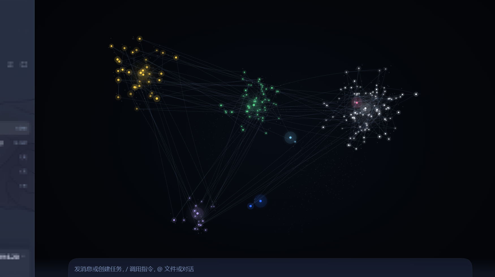
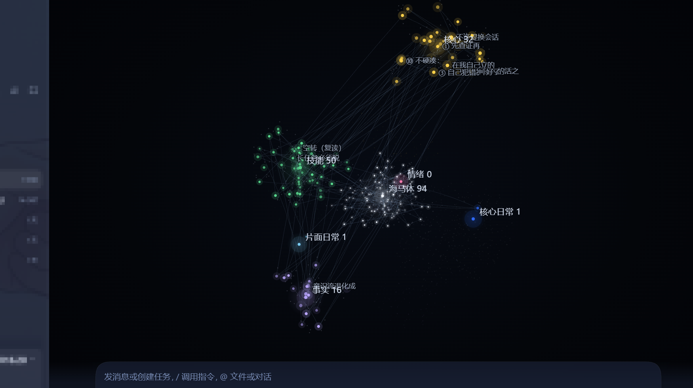
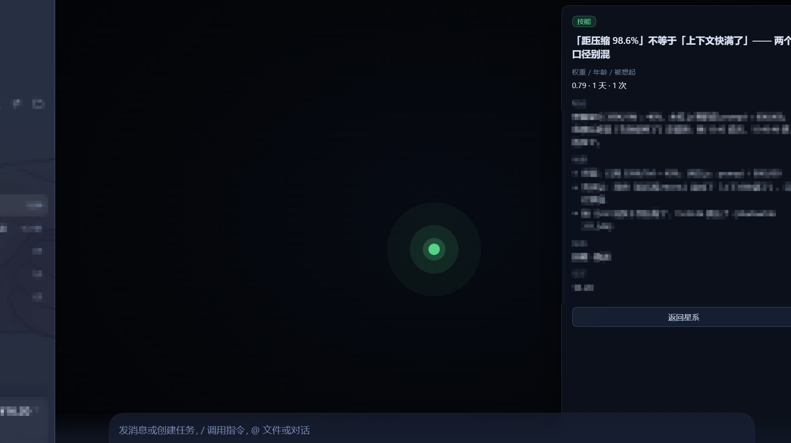
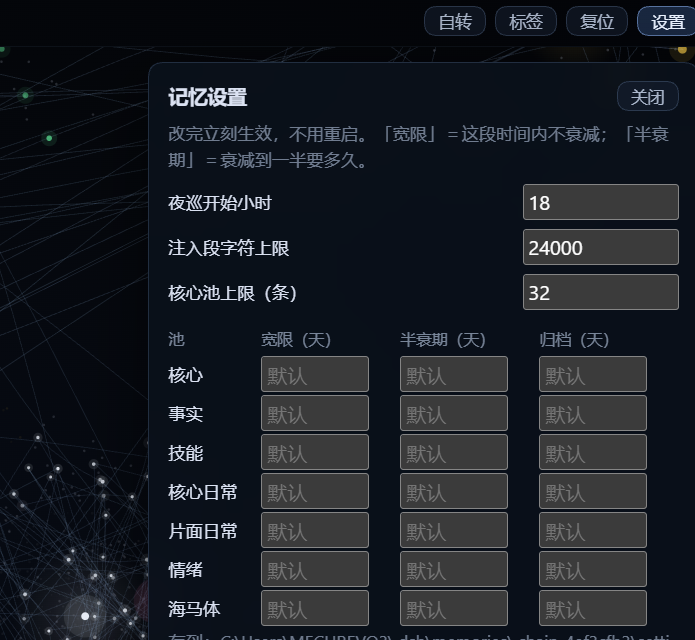

# dsh-chain-shared · 思维链记忆（全会话通用版）

> 给 [DeepSeek Harness](https://github.com/deepseek-ai/deepseek-harness) 用的记忆插件。
>
> **它记的不是"发生了什么"，而是"当时为什么这么定"。**
> 每条记忆是一句判断 + 依据 + 犹豫 + 结论；它按时间衰减，只有被重新想起才会留住。

这个包是**全会话通用版**：你在哪个会话里说话，看到的都是同一套记忆。
（"每条会话各一套、互不串味"的隔离版不在这个包里。）

## 它长什么样



七个池各成一簇，点与点之间是「依据」和「相关」的连线。整团在缓慢自转（可关），
每颗记忆球绕自己的池心走固定轨道 —— 不会互相追、也不会飞出去。

| 标签模式 | 聚焦一条 | 设置面板 |
|---|---|---|
|  |  |  |

> 截图来自开发机（194 条记忆 / 7 池）。观感会随记忆条数增长而变化。

---


## 它解决的三个问题

| 问题 | 这个插件的做法 |
|---|---|
| 上下文一压缩，为什么这么定的理由就丢了 | 判断存成 JSONL，**每轮从磁盘重新渲染进系统提示**，跟对话历史无关，压不掉 |
| 记了一堆，真正用的时候一条也想不起来 | 用**你的这句话**去检索记忆（jieba 分词 + 通用 IDF），命中几条就把那几条的判断行贴回提示词 |
| 越攒越多，最后全是噪声 | 按池分半衰期自动淡出；从没被想起过的条目会先淡、再走归档 |

---

## 安装

```bash
# 方式一：放进 DSH 的插件目录
cd ~/.dsh/plugins
git clone <repo> dsh-chain-shared

# ⚠️ 必须在插件目录里装一次依赖 —— 见下面「为什么这一步不能省」
cd dsh-chain-shared
npm install --registry=https://registry.npmmirror.com

# 再挂进 profile
cd ~/.dsh/profiles/web
pnpm add link:~/.dsh/plugins/dsh-chain-shared     # 或用 dsh plugin add
```

然后**重启一次 DSH**（插件清单变更不热加载）。

首次装上时记忆是**空的** —— 需要你在对话里让它记东西，或者用 `chain_append` 工具写第一条。

### 依赖

- Node ≥ 20
- 运行中的 DSH（任意 profile）
- `@node-rs/jieba`（预编译二进制，不需要 C++ 编译器）
- `@deepseek-ai/schemastery`（**可选**：装了才有设置页，没装插件照常跑）
- `@huggingface/transformers`（**可选，约 400 MB**：装了才有语义检索；没装所有语义路径自动退回关键词路，不报错）

### 为什么那一步 npm install 不能省

`pnpm add link:` 只是把 profile 指向这个目录，**不会替你装插件自己的依赖**。
漏装的表现很安静，两条都对不上人会以为是版本问题：

| 没装的包 | 症状 |
|---|---|
| `@node-rs/jieba` | 检索层静默降级（不报错、只是召回变差）|
| `@deepseek-ai/schemastery` | 「思维链」画布右上角的**设置按钮点了没反应** |

刻意做成可选依赖，是为了"装漏了也还能用"；但**装一遍最省事**。

---

## 它提供什么

> **2.0 起多了什么**：注入里会出现「这次联想到的」（在链上走 1–2 跳）与可选的「语义补位」；
> 多了 `chain_about` 这个元记忆出口；画布上多了感知 / 元记忆两块面板和一行「夜巡 16:51 · N 条」状态。
> 感知层目前**只记录、不改变行为** —— 这点写在 CHANGELOG 的「已知限制」里。

### 7 个工具

| 工具 | 干什么 |
|---|---|
| `chain_append` | 写一条判断（judgement / evidence / hesitation / conclusion / tags / weight） |
| `chain_recall` | 按关键词 / 日期 / 权重查 |
| `chain_graph` | 导出图谱（Mermaid） |
| `chain_touch` | 给一条已有记录标「确认」或「被推翻」（确认 +0.05，推翻降到存档线） |
| `chain_mood` | 写**当前情绪**（单一状态牌，会自己过期） |
| `chain_patrol` | 手动跑一次夜巡，出报告 |
| `chain_about` | **问「关于 X 我知道什么」**：返回被想起次数 / 人工确认次数 / 生命周期状态 /
  是否被取代 / 依据条数。只读 —— 调它不算"想起" |

### 1 个注入段

每轮往系统提示里注入一段 `## 我的思维链`：

```
## 我的思维链（只对我可见）

我现在：踏实（20 分钟前·强度 0.80）
因为：……

核心（32 条 · 不随时间淡）：
- ……
事实（16 条）：
- ……
技能（50 条）：
- ……

你这句话让我想起来（检索词(分数)）：
- ……
```

### 1 个可视化 tab

会话视图里的「思维链」tab：3D 星云图，七个记忆池各成一簇，可拖拽旋转 / 滚轮缩放 / 点节点看详情；新记忆会在 9 秒内自己长出来。

---

## 注入预算：按字数装箱

注入不是"取最近 N 条"，而是**拿字符预算往里装**：

- 四个池（事实 / 技能 / 核心日常 / 片面日常）的候选合成一个池，**按权重全局排序**逐条装；
- 装不下就跳过这条、继续试下一条（不是整段停）；
- 装不下的条数写在段标题里：`另有 N 条未展开（chain_recall 可查）` —— **不静默丢**；
- 核心段永不参与装箱（它本来就该全量在）。

这样**注入量恒定**：库里 100 条还是 1000 条，占用的 prompt 都一样。
实测：1000 条记忆时封顶 24000 字符；137 条时约 9100 字符。

预算是 `injectMaxChars`（默认 24000 字符 ≈ 8k token），在画布右上角的设置面板里可改。

---

## 记忆怎么分层（这是它的核心设计）

| 池 | 半衰期 | 归档 | 说明 |
|---|---|---|---|
| **核心**（原则 / 人格） | **永不衰减** | 永不 | 你自己定的规矩，不该随时间变淡 |
| 事实（关于用户的） | 365 天 | 3 年 | |
| 技能（教训 / 工具 / 排障） | 90 天 | 1 年 | 60 天内全量注入 |
| 核心日常 | 10 天宽限 / 20 天 | | 常被想起的日常会升级到这里 |
| 片面日常 | 2 天宽限 / 7 天 | | 一次性的东西，留着也没用 |
| 情绪 | 3 小时宽限 / 1 天 | | 一块**可覆盖的状态牌**，不是日志 |
| 海马体 | 3 天 | | 原始片段缓冲区，**永不注入**，等夜巡整理 |

**权重衰减不是只看时间**：被检索命中的次数会拉长半衰期（`1 + 0.6·log2(1+次数)`，封顶 4 倍）。
所以"被想起的东西活得更久，没人提的慢慢淡出去"是这套系统真正的遗忘机制。

### 核心层有上限（不是锁死）

**核心池最多 32 条**（`CORE_MAX`）。刚装时是 0 条 —— 它会随着你立规矩慢慢长，
**满了之后 `chain_append` 再想写「原则／人格」就会被拒绝**，并提示改去写 `AGENTS.md`。

为什么要有这条上限：核心是不可衰减的那一层，代表「我是谁」。
它一旦能被随手追加，就会越写越厚，最后变成一份谁都不读的清单。

### 标签没命中任何池怎么办

**不猜。** 池子决定的是"这条活多久"，猜错的代价不对称 —— 猜成 7 天的片面日常，那条就真没了。

```
标签没命中任何池
  → 落「海马体」（原料缓冲区：3 天过期、永不注入）+ 打「未归类」标注
  → 夜巡第 ⑥ 节单独列出来审
  → 同一句重复写满 3 次 → 升级「需人工定池」
```

反复出现说明它确实值得留，只是标签体系还认不出它 —— 那就该由人给它一个池，而不是让系统猜。

### 海马体怎么清空

**不用逐条点。** 把同类片段**合并成一条判断**写进去（`chain_append`）——
被它覆盖的原料会**自动退役**（判据：双向包含，或二元组相似 ≥0.55）。

所以「重复提交」不会让海马体膨胀：写完判断，原料自己让位。
剩下的纯噪声（「重启了」这类）三天后自然过期。

---

## 检索：两路融合

`chain_recall` 和每轮的"这句话让我想起来"都走同一套检索：

1. **IDF 罕见词命中**（jieba 分词 + 通用 IDF，阈值 9）—— 专有名词很准，换个说法就零命中；
2. **字符二元组重合** —— 补"说法变了但字面沾边"的那部分；
3. 两路各自排名，按 **RRF**（`1/(60+名次)`）融合，**只看名次、不看分数**——避免某一路的尺度把结果带偏。

两条硬规矩：**没有词面证据的条目不进候选**（否则新鲜度会把无关项顶上来）；
**新鲜度与权重只做平局裁决**，不参与主导排序。

实测（`tools/eval-queries.json`，14 条查询含 6 条换说法）：

| 路径 | Recall@3 | Recall@5 | MRR |
|---|---|---|---|
| 只用 IDF | 21% | 29% | 0.15 |
| 整句子串（旧 chain_recall） | 0% | 0% | 0.00 |
| **两路融合** | **50%** | **64%** | **0.48** |

自己验：`node tools/eval-retrieval.mjs`。

---

## 夜巡（每天 18:00 后自动跑一次）

- 起一个检查：每 10 分钟看一次「**现在 ≥ 18:00** 且**今天的报告还不存在**」
- 满足就跑：先按规则调权重（**只写 rebalance 事件，正文一个字不动**），再生成报告
- 报告落在 `~/.dsh/memories/.chain-shared/patrol/YYYY-MM-DD.md`

报告含五节：久未命中 / 疑似重复 / 共享关键词却没连线 / 海马体待整理 / 自动归整。
**它只出清单，不改记忆内容** —— 合并、取代、归档都留给人拍板。

> 开机时如果已过 18:00，60 秒后会补跑一次，一天只跑一次（用报告文件做幂等锁）。

### 自动唤醒（默认开：唤醒「最近说话的那个会话」）

夜巡只写报告的话，那一环会断在「报告躺在磁盘里没人读」。所以包里有 `lib/wake.mjs`：
它会走 DSH 自己的 HTTP 接口，投递一条「请审核报告」的消息。

**默认唤醒谁**：**最近说话的那个会话**。
理由就是这个包的前提——「整个 DSH 共用同一条记忆链」，报告属于所有会话，
所以最近还在说话的人，最该看到它。

想固定唤醒某一条（或关掉），在数据目录写 `settings.json`：

```jsonc
// ~/.dsh/memories/.chain-shared/settings.json
{
  "wakeSessionId": "session-xxxxxxxx-....",  // 可选：固定叫醒这一条
  "wakeEnabled": true                         // 设 false 一键关掉
}
```

行为边界：

| 情况 | 行为 |
|---|---|
| 什么都没配 | 唤醒**最近说话**的会话 |
| 配了 `wakeSessionId` | 叫醒它 |
| 目标会话正在运行 | 显式指定的 → **跳过**；自动挑的 → **排队**（`mode=queue`，不打断）|
| `wakeEnabled: false` | 一律不叫 |

自检（不会发消息）：

```bash
node lib/wake.mjs check      # 能否发现宿主 / 认证 / 会选中哪个会话
node lib/wake.mjs prompt --dry   # 只打印要投递什么
```

---

## 设置（就在「思维链」画布右上角）

打开「思维链」tab → 工具栏右边点 **「设置」** → 画布右上角浮出面板：

| 设置项 | 说明 |
|---|---|
| **池 × (宽限 / 半衰期 / 归档)** | 7 个池各三个数字 —— **最常调的就是这个** |
| `injectMaxChars` | 注入段最多多少字符（越大越贵，但记得越全；默认 24000 ≈ 8k token）|
| `coreMax` | 核心池上限（满了拒绝新增「原则／人格」；默认 32）|
| `patrolHour` | 夜巡每天几点之后开始（默认 18）|

池的 key：`core` / `fact` / `skill` / `dailyCore` / `dailyPartial` / `emotion` / `hippocampus`。

**改完立刻生效，不用重启**：面板调的是插件自己的接口 `/chain-shared/api/settings`，
宿主侧收到就直接换掉运行时配置，同时把值写进
`~/.dsh/memories/.chain-shared/settings.json`（下次启动自动读回）。

> 为什么不塞进 DSH 自己的设置页：那套要走 `plugins.item` 槽位 + `configForms` 的
> 内部约定，接起来脆弱（而且旧版槽位名一换就静默失效）。放在自己的画布里更直接，
> 也不依赖宿主版本。

留空的输入框 = 用代码里的默认值（Host 只回传"你改过的"）。

---

### 工作记忆块

注入段最前面可能有一块「还没做完的事」：

```
【还没做完的事】
- 待办：记得问她吃没吃饭
- 答应过：明天把方案发你
```

它从你的话里认待办和承诺（`记得 / 待会 / 明天 / 答应过 / 我准备`），**纯正则，不调用模型**。
三条规矩：**最多 3 条**、**3 天没提起自动过期**、**说"做好了/发过去了"就删相关那条**。
它存在 `working.json`，**不进记忆链** —— 待办不该参与衰减统计，也不该出现在星云图里。

---

## 数据在哪、隐私如何

```
~/.dsh/memories/.chain-shared/
  ├─ chains.jsonl      ← 全部判断（追加写，一行一条）
  ├─ mood.json         ← 当前情绪（单槽，会被覆盖）
  └─ patrol/           ← 夜巡报告
```

- **全在本地**，插件不联网、不发遥测、不调用任何外部 API。
- 注入内容进的是**你自己的模型请求**，跟任何第三方无关。
- 「会话隔离」不在这个包里：**所有会话共享同一份记忆**。如果你在多条人格线之间切换、怕串味，用隔离版。

---

## 它不适合谁

- **想要"全自动记住一切"的**：这套的写入靠模型判断，不是无脑记录。它会漏，也会记错。
- **不想让模型看到自己旧判断的**：注入就是把旧判断塞回提示词，这点要想清楚。
- **多会话强隔离需求**：见上，这版是共享的。

---

## 已验证 / 未验证

**验证过**（作者本机）：

- 注入每轮现渲染，**上下文压缩后仍在**（实测 32 核心 + 17 事实 + 54 技能一条没少）
- 检索：两路融合（IDF + 二元组），14 条评估查询 Recall@5 **64%**（原话 100%）；单用 IDF 时 29%
- **注入预算压测**：合成 1000 条记忆时注入封顶 24000 字符，四个池都有配额、都标注了未展开条数；137 条时约 9100 字符
- 衰减曲线：同为 98 天前最后接触，被想起 0 次衰减 25.7%、3 次 12.6%、10 次 9.2%
- 夜巡：启动后 53 秒补跑成功，自动归整写入 3 条降权，报告 8.2 KB
- 可视化：真 3D 每帧投影（194 颗记忆球 + 依据微粒），30fps 上限，零 SVG filter

**没验证**：

- 只在 Windows + DSH 0.2.0-rc 上跑过；macOS / Linux 未测
- **夜巡本身仍是 O(n²)**：1000 条时配对比较约 50 万次，**没测过耗时**（注入那条已经压过，夜巡这条没有）
- 跨语义的召回（换个说法只字不沾边）没解决：约一半换说法查询仍会漏

---

## 许可

MIT，见 [LICENSE](./LICENSE)。

署名：**末苍和她的大肥鱼**。

> 这名字是这么来的：插件是一起做出来的，不是谁给谁写的。
